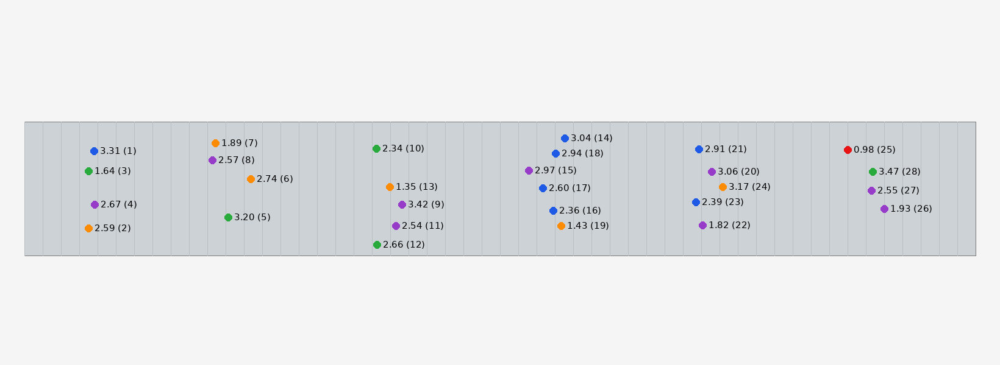
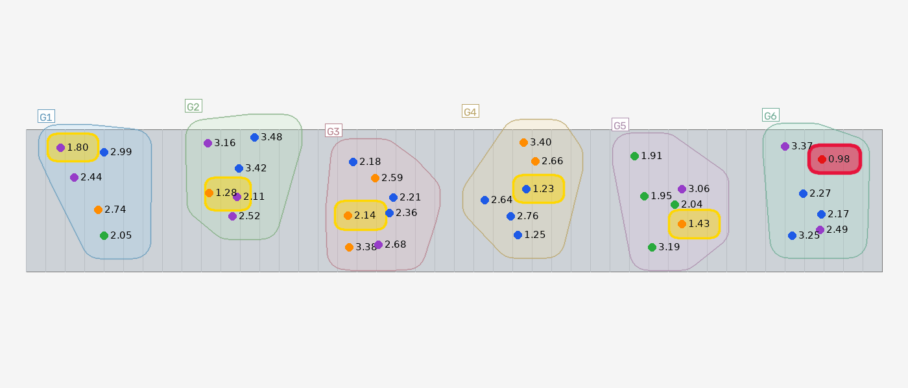
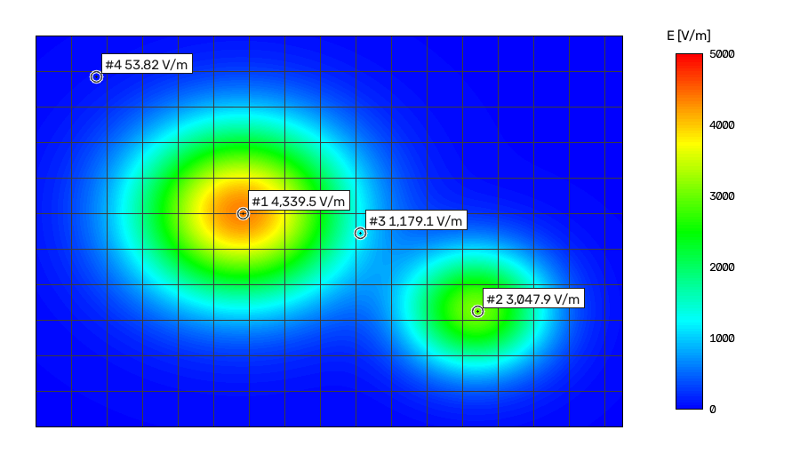

# PostFX 2D — 2D 해석결과 이미지 후처리

해석결과 캡처 이미지(클립보드 / 파일)를 받아 **후처리된 PNG** 와 **요약 데이터 테이블(CSV)** 을 만드는 Windows 프로그램입니다.

## 모드 1 · 최소안전율부위

| 점 색상 | 의미 |
|---|---|
| 🟠 주황 | W1 |
| 🟢 초록 | W2 |
| 🔵 파랑 | W3 |
| 🟣 보라 | W4 |
| 🔴 빨강 | Global Minimum Point |

점 옆 숫자 = 해당 지점의 안전율

1. 색상(HSV)으로 원형 점 검출 → W1~W4 / Global 분류
2. OCR(RapidOCR)로 숫자 인식 → 가장 가까운 점과 짝짓기
3. 점+숫자 군집을 거리 기반으로 자동 그룹화 (왼쪽부터 G1, G2, …)
4. 그룹 전체를 감싸는 **연한 파스텔 음영** (그룹별 다른 색)
5. 그룹별 최소 안전율 위치 **노란 하이라이트**, 빨간 점(글로벌 최소)은 **빨간 하이라이트**

출력: `이름_minSF.png` + `이름_minSF_summary.csv` (Excel 호환 UTF-8)

| 원본(합성 샘플) | 결과 |
|---|---|
|  |  |

## 모드 2 · 전계 값 읽기 (Rainbow map)

전계 분포 rainbow map 이미지를 열고 **최소/최대값** 을 입력하면, 클릭한 지점의 색을 컬러맵에 대응시켜 전계 값을 읽습니다.

- **컬러맵**: Rainbow(파랑→빨강) · Jet · Turbo · **범례에서 추출**
  - 범례에서 추출: `🎯 범례(컬러바) 지정하기` → 이미지 속 컬러바를 **최소 끝 → 최대 끝** 으로 드래그. 해석 툴마다 색 배치가 달라서 이 방법이 가장 정확합니다.
- **범례 저장**: 한 번 지정한 범례 색상은 `⟲ 범례 초기화` 를 누르기 전까지 계속 유지됩니다. 새 이미지를 붙여넣어도, 프로그램을 껐다 켜도 그대로입니다 (저장 위치 `%APPDATA%\PostFX2D\settings.json`). 최소/최대값은 직접 입력합니다.
  - 추천 흐름: 범례가 보이는 전체 화면을 한 번 캡처 → 범례 지정 → 이후 원본 툴에서 확대한 캡처만 연달아 붙여넣고 측정
- **클릭** 측정 · **우클릭** 삭제 · `Ctrl+Z` 되돌리기 · 마우스를 올리면 상태바에 실시간 값
- **로그 스케일** 지원
- 색 오차가 큰 점(배경, 경계선, 범례 밖 색)은 `불확실` 로 빨갛게 표시
- 출력: 측정점이 표시된 `이름_field.png` + `이름_field_summary.csv` (#, X, Y, 전계, 컬러맵 위치 %, 색 오차, 신뢰)

| 합성 샘플 측정 결과 (범위 0~5000 V/m) |
|---|
|  |

합성 샘플 300점 검증: 평균 오차 약 11 V/m (범위의 0.2%), 최대 약 140 V/m (메쉬선 근처).

## 사용법 (exe)

GitHub Actions → **PostFX2D Windows Build** → Artifact `PostFX2D-windows` 에서 `PostFX2D.exe` 다운로드.

- `Ctrl+V` 클립보드 캡처 붙여넣기 (Win+Shift+S 로 캡처 후) — 붙여넣으면 바로 분석
- `Ctrl+O` 파일 열기 · `Ctrl+S` PNG+CSV 저장 · `Space` 원본/결과 전환
- **확대/축소**: 마우스 휠(커서 위치 기준) · `Ctrl +` / `Ctrl -` · `Ctrl+0` 화면 맞춤 · 미리보기 상단 `－ ＋ 맞춤` 버튼
- **이동**: 확대 상태에서 왼쪽 드래그 또는 휠 클릭 드래그 (모드 2에서도 드래그는 이동, 짧은 클릭만 측정)
- **화질** (미리보기 상단, 기본값 `원본`): `원본 (픽셀 그대로)` · `부드럽게 보기` (확대 시 bicubic) · `선명 확대 ×2 / ×4` (Lanczos + 샤프닝, 저장도 해당 배율)
  - 분석·측정 값은 화질 옵션과 관계없이 **항상 원본 픽셀에서** 읽습니다.
  - 저해상도+JPEG 합성 맵 검증: 부드러운 보간이 픽셀 블록보다 색→값 오차가 10~27% 작음. AI 초해상도는 숫자/색을 지어낼 수 있어 넣지 않았습니다.
- 그룹이 잘못 나뉘면 **그룹 수** 를 지정 후 다시 실행
- OCR 이 숫자를 잘못 읽으면 **전체 점** 탭에서 더블클릭해 수정 → 자동 재그리기

## 개발

```bash
pip install -r requirements.txt
python run_app.py                       # GUI
python cli.py 입력.png [출력.png] [--groups 6]
python tools/make_sample.py tools/sample.png
python tools/make_field_sample.py tools/field_sample.png
```
